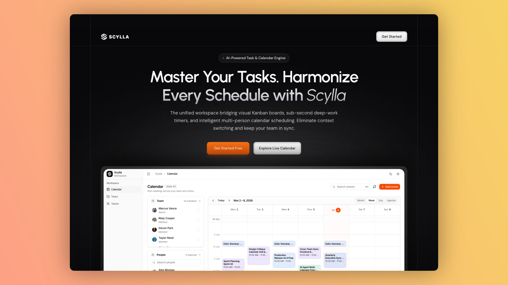
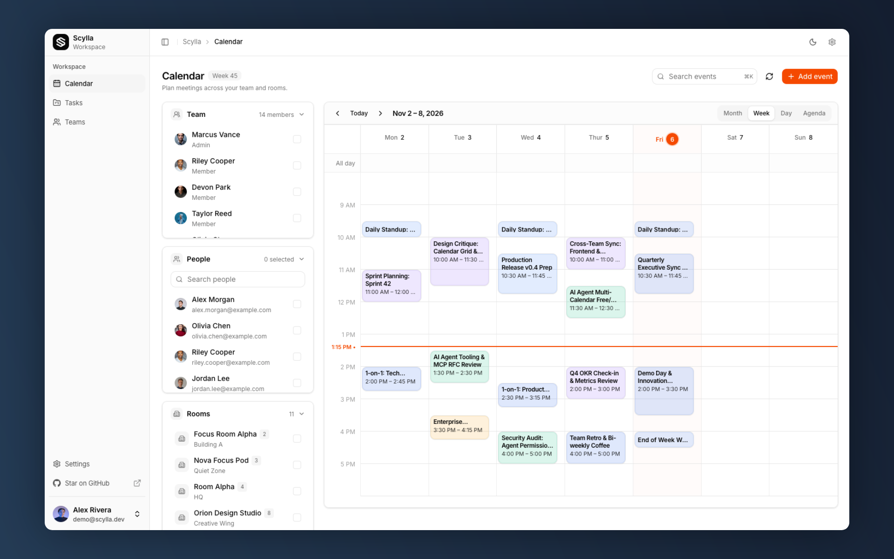
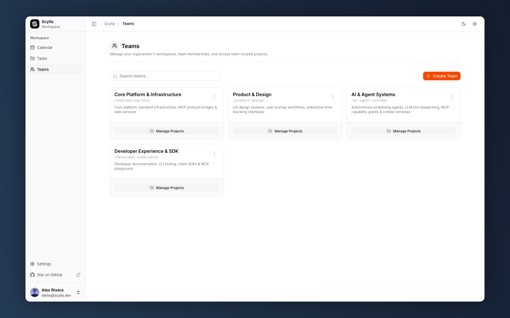
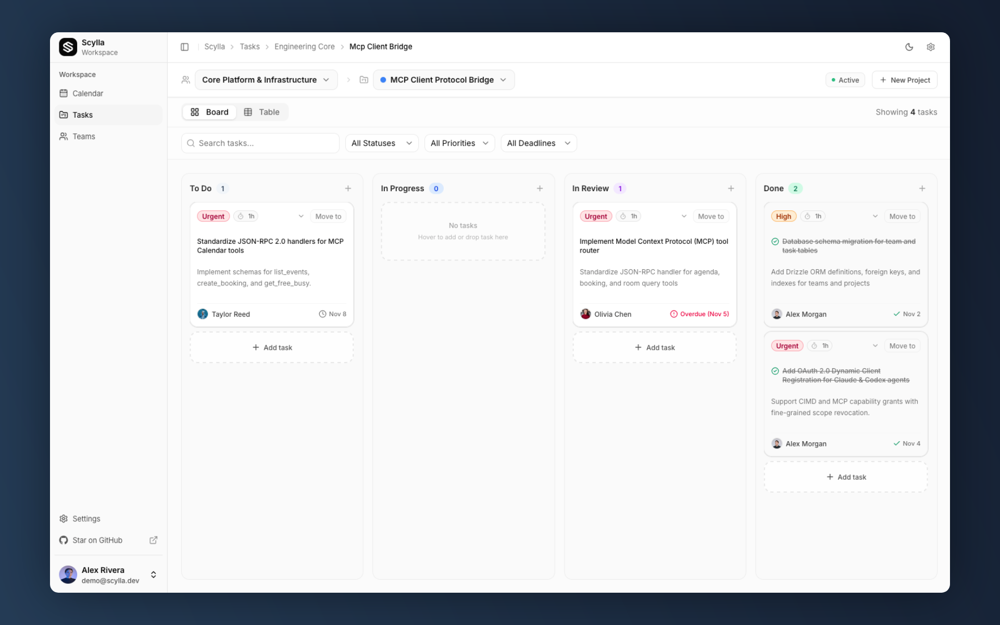

<p align="center">
  
</p>

<h1 align="center">Scylla</h1>

<p align="center">
  <strong>Team calendar, meeting rooms, and task tracking in one place — with built-in MCP support for AI agents.</strong>
</p>

<p align="center">
  <a href="https://nextjs.org/"></a>
  <a href="https://bun.sh/"></a>
  <a href="https://www.typescriptlang.org/"></a>
  <a href="https://tailwindcss.com/"></a>
  <a href="https://modelcontextprotocol.io/"></a>
  <a href="https://www.postgresql.org/"></a>
  <a href="LICENSE"></a>
</p>

<p align="center">
  <a href="#why-scylla">Why Scylla</a> •
  <a href="#visual-tour">Visual Tour</a> •
  <a href="#getting-started">Quickstart</a> •
  <a href="#ai-agents--mcp-manage-everything-from-your-editor">Manage Everything with MCP</a>
</p>

---

## Why Scylla?

Coordinating work across a team is usually annoying because everything lives in different tabs:

- **Calendar chaos**: Scheduling a quick sync with 3 or 4 teammates means opening multiple Google Calendar windows, eye-balling overlapping blocks, or sending 10 Slack messages back and forth just to find 30 minutes.
- **Disconnected tasks**: Tasks live on a board (like Jira or Linear), but real time is spent in meetings and calendar blocks. Managers end up asking "what did everyone actually work on this week?" because the calendar and the task board never talk to each other.
- **Meeting room scramble**: You finally find a time that works, but now you have to open another tool to find an empty room with a video screen or enough seats.
- **AI agents locked out**: Tools like Claude and Cursor can write code and summarize docs, but they cannot check your calendar, book a room, or move your task to "Done" unless you leave your editor and click around by hand.

**Scylla puts your calendar, team rooms, and project tasks on one screen.** You can see who is free, reserve a room that fits, attach meetings directly to the tasks people are working on, and let your AI agent do the busywork for you.

---

## Visual Tour

### 1. Team Calendar & Timeline Grid

See everyone's availability layered together, check meeting room occupancy, and drag to schedule new events.

<div align="center">
  
</div>

### 2. Teams & Workspaces

Group people into teams, assign member roles, and organize projects in one clean directory.

<div align="center">
  
</div>

### 3. Task Boards Linked to Your Week

Connect meetings to actual tasks with assignees, priorities, and deadlines. Managers can see exactly what progressed during the week without scheduling another status meeting.

<div align="center">
  
</div>

---

## What Scylla Does

- **Find common free time**: Overlay teammate schedules to spot open slots without back-and-forth messages.
- **Track weekly work**: Attach meetings directly to project tasks so everyone knows what was discussed and what was completed.
- **Book the right room**: Filter meeting rooms by capacity and equipment (video screens, quiet pods, conference setups).
- **Google Calendar sync**: Two-way sync keeps your Google Calendar events and Scylla bookings aligned.
- **Public booking links**: Share personal or team `/book/[slug]` links so external guests can pick an open time.

---

## Getting Started

### Prerequisites

- [Bun](https://bun.sh/) (v1.2+) or Node.js (v20+)
- [Docker](https://www.docker.com/) (for local PostgreSQL)

### 1. Clone & Set Up Environment

```bash
git clone https://github.com/belastrittmatter/Scylla.git
cd Scylla
cp .env.example .env
```

### 2. Start PostgreSQL & Push Database Schema

```bash
# Start local Postgres in Docker
bun run db:up

# Push schema tables
bun run db:push
```

Helpful database commands:

- `bun run db:up` — Start the database container
- `bun run db:down` — Stop the container
- `bun run db:studio` — Open the Drizzle visual database inspector

### 3. Seed Initial Data

Populate the database with default event types, working hours, and initial users:

```bash
bun run db:seed
```

### 4. Run the App

```bash
bun install
bun run dev
```

Open [http://localhost:3000](http://localhost:3000) in your browser.

---

## Google Workspace Room Sync

If your company uses Google Workspace, you can pull your conference rooms straight into Scylla:

```bash
curl -X POST http://localhost:3000/api/rooms/sync
```

_(Requires `GOOGLE_CLIENT_ID` and `GOOGLE_CLIENT_SECRET` in your `.env` file with Google Directory read permissions)._

---

## Tech Stack

- **Framework**: Next.js 16 (App Router, React 19)
- **Language**: TypeScript
- **Styling**: Tailwind CSS v4 & shadcn/ui primitives
- **Database**: PostgreSQL 16 with Drizzle ORM
- **Auth**: Better Auth (Google OAuth, email/password, and MCP agent auth)
- **Runtime**: Bun

---

## Testing & Code Quality

```bash
# Run tests
bun test

# Check formatting
bun run format:check

# Auto-format files
bun run format

# Run linter
bun run lint
```

---

## AI Agents & MCP: Manage Everything from Your Editor

The best part of Scylla is that **you rarely need to open the browser to manage your schedule or tasks.**

Scylla includes a built-in **Model Context Protocol (MCP)** server. When you connect it to **Claude Desktop**, **Cursor**, or any other MCP-enabled agent, your assistant can interact with your calendar and project boards directly.

You can simply tell your agent:

- **Schedule a meeting**:

  > _"Find 30 minutes with Taylor and Riley tomorrow afternoon, book Room Alpha, and send the invite."_

- **Create a task**:

  > _"Add a high-priority task 'Fix OAuth token refresh' to the Core Platform project and assign it to me."_

- **Update task progress**:

  > _"Move task #104 to In Review and note that all unit tests are passing."_

- **Check availability**:
  > _"What meetings do I have on Thursday?"_ or _"Is the Orion conference room free at 2 PM?"_

The agent talks to Scylla through MCP in the background: checking free/busy windows, picking the right room, and updating your tasks without you ever leaving your editor or chat window.

---

## License

MIT License. See [LICENSE](LICENSE) for details.
