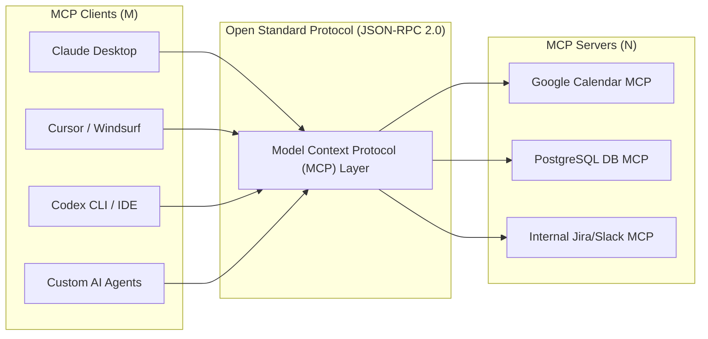
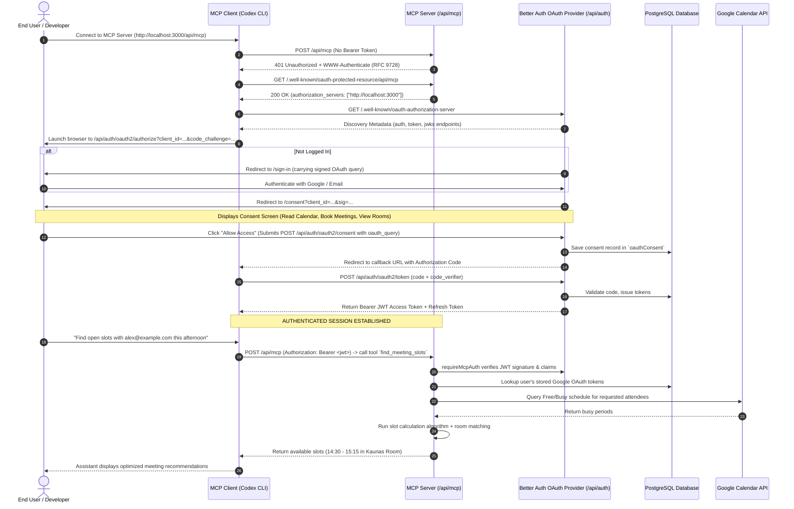
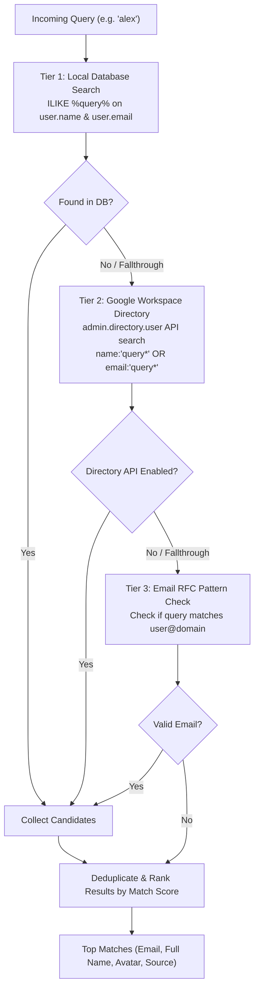
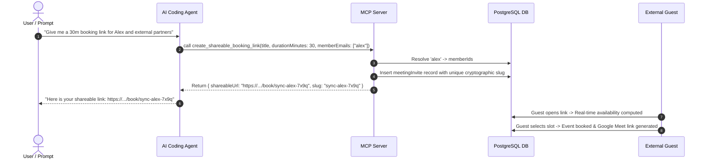

# MODEL CONTEXT PROTOCOL (MCP) & OAUTH 2.1 AUTHENTICATION DEEP DIVE

> **Comprehensive Technical Architecture & Presentation Guide**  
> Project: **Scylla AI Calendar Scheduling Assistant & MCP Server**  
> Author: **MCP Research & Engineering Team**  
> Date: **October 16, 2026**

---

## TABLE OF CONTENTS

1. [Section 1: Model Context Protocol (MCP) Fundamentals](#section-1-model-context-protocol-mcp-fundamentals)
   - 1.1 The Core Problem: The $M \times N$ Integration Bottleneck
   - 1.2 What is MCP? ("The USB-C for AI Applications")
   - 1.3 System Topology: Host vs. Client vs. Server
   - 1.4 The 3 Core Primitives: Tools, Resources, Prompts
   - 1.5 Transport Layer: `stdio` vs. `Stream HTTP (SSE / POST)`
2. [Section 2: Authentication & Authorization in MCP](#section-2-authentication--authorization-in-mcp)
   - 2.1 Why OAuth 2.1 Over Static API Keys?
   - 2.2 RFC 9728: OAuth Protected Resource Metadata
   - 2.3 Client Identity Metadata Document (CIMD)
   - 2.4 End-to-End Authentication Sequence Diagram
3. [Section 3: Project Architecture & Engineering Implementation](#section-3-project-architecture--engineering-implementation)
   - 3.1 Technology Stack
   - 3.2 Better Auth Server Configuration (`mcp`, `jwt`, `bearer`, `cimd`)
   - 3.3 Database Architecture: 8 OAuth 2.1 Tables
   - 3.4 Production MCP Tools Catalog (10 Business Tools)
   - 3.5 Token-to-User Identity Mapping & Google Calendar Integration
4. [Section 4: Technical Case Study — Demystifying `missing oauth query`](#section-4-technical-case-study--demystifying-missing-oauth-query)
   - 4.1 Incident Context & Error Manifestation
   - 4.2 Deep Dive into `@better-auth/oauth-provider` Internals
   - 4.3 Root Cause Analysis (Signed Query HMAC Verification)
   - 4.4 The Engineering Solution & Verification
5. [Section 5: Client Setup & Live Demonstration Playbook](#section-5-client-setup--live-demonstration-playbook)
   - 5.1 Codex Configuration (`.codex/config.toml`)
   - 5.2 Step-by-Step Live Demo Script
6. [Section 6: Presentation Q&A Defense Cheat-Sheet](#section-6-presentation-qa-defense-cheat-sheet)
7. [Section 7: Smart Teammate Resolution & Universal Nickname Architecture](#section-7-smart-teammate-resolution--universal-nickname-architecture)
   - 7.1 The Nickname Problem in Natural Language Assistant Interactions
   - 7.2 Three-Tier Resolution Pipeline (`resolve_user`)
   - 7.3 Multi-Tool Nickname Propagation (`find_common_meeting_slots` & `book_meeting`)
8. [Section 8: Rich UI / Visual Schedule Comparison in MCP](#section-8-rich-ui--visual-schedule-comparison-in-mcp)
   - 8.1 Visual Density & Cognitive Load in Chat Clients
   - 8.2 Self-Contained HTML Card Architecture (`mcp-html-builder.ts`)
   - 8.3 The `compare_schedules` Tool Workflow
9. [Section 9: Shareable Booking Links Engine](#section-9-shareable-booking-links-engine)
   - 9.1 Self-Serve Calendar Links vs. Direct Booking
   - 9.2 The `create_shareable_booking_link` Tool Architecture
   - 9.3 Public Booking Endpoint (`/book/[slug]`) Lifecycle
10. [Section 10: Engineering Roadmap & Knowledge Guide — What to Learn & Build Next ("Cần học để làm thêm")](#section-10-engineering-roadmap--knowledge-guide--what-to-learn--build-next-cn-hc--lm-thm)
    - 10.1 MCP Prompts Primitive (`server.registerPrompt`)
    - 10.2 MCP Resources Primitive (`server.registerResource` & `ResourceTemplate`)
    - 10.3 Progress Notifications & Streaming Feedback (`ctx.reportProgress`)
    - 10.4 Distributed Locking & Double-Booking Prevention (Redis / Postgres Advisory Locks)
    - 10.5 Human-in-the-Loop Confirmation Primitives (MCP Elicitation & Sensitive Tool Gates)
    - 10.6 Cross-Timezone Harmonization & DST Edge Cases

---

## SECTION 1: MODEL CONTEXT PROTOCOL (MCP) FUNDAMENTALS

### 1.1 The Core Problem: The $M \times N$ Integration Bottleneck

Prior to MCP, connecting Large Language Models (LLMs) to enterprise data sources and business tools suffered from the classic **$M \times N$ Integration Dilemma**:

- If there are $M$ AI frontends (Cursor, Windsurf, Claude Desktop, Codex CLI, Custom Autonomous Agents) and $N$ enterprise systems (Google Calendar, Slack, GitHub, PostgreSQL, Jira), developers had to build and maintain $M \times N$ proprietary connectors.
- Each platform maintained its own function-calling convention, context-injection format, and security model.



### 1.2 What is MCP? ("The USB-C for AI Applications")

Introduced as an open standard by Anthropic in November 2024, **Model Context Protocol (MCP)** standardizes how AI applications discover, inspect, and execute external context and actions:

- **Reduces integration complexity from $M \times N$ to $M + N$**: An MCP Server created once can be consumed by any compliant MCP Host/Client out of the box.
- Standardizes bidirectional messaging using **JSON-RPC 2.0**.
- Decouples AI reasoning engines from operational infrastructure.

---

### 1.3 System Topology: Host vs. Client vs. Server

The MCP specification defines three distinct actors:

```
┌────────────────────────────────────────────────────────┐
│                        MCP HOST                        │
│  (e.g., Codex, Claude Desktop, Cursor, Custom Agent)   │
│                                                        │
│  ┌───────────────┐               ┌──────────────────┐  │
│  │   LLM Engine  │◄─────────────►│    MCP CLIENT    │  │
│  │ (GPT-4, Claude│               │  (Transport &    │  │
│  │   Gemini Pro) │               │   Protocol Mgr)  │  │
│  └───────────────┘               └────────┬─────────┘  │
└───────────────────────────────────────────┼────────────┘
                                            │ JSON-RPC 2.0
                                            │ (Stream HTTP / SSE)
                                            ▼
┌────────────────────────────────────────────────────────┐
│                       MCP SERVER                       │
│             (Next.js 15 Backend /api/mcp)              │
│                                                        │
│  ┌─────────────────┐ ┌─────────────────┐ ┌──────────┐  │
│  │      TOOLS      │ │    RESOURCES    │ │ PROMPTS  │  │
│  │ (Exec Actions)  │ │ (Read-only data)│ │(Templates│  │
│  └────────┬────────┘ └─────────────────┘ └──────────┘  │
│           │                                            │
│           ▼                                            │
│  ┌──────────────────────────────────────────────────┐  │
│  │ Business Logic & APIs (Google Calendar, DB, etc.)│  │
│  └──────────────────────────────────────────────────┘  │
└────────────────────────────────────────────────────────┘
```

1. **MCP Host**: The coordinating application facing the end user. It controls UI, conversations, model lifecycle, and permissions.
2. **MCP Client**: The internal module within the Host that initiates connections, manages capabilities negotiation, and translates LLM tool invocations into JSON-RPC calls.
3. **MCP Server**: A standalone service exposing capabilities (Tools, Resources, Prompts) via the protocol.

---

### 1.4 The 3 Core Primitives of MCP

| Primitive     | Direction                   | Concept                                                                                                                      | Example in Our Project                                                       |
| :------------ | :-------------------------- | :--------------------------------------------------------------------------------------------------------------------------- | :--------------------------------------------------------------------------- |
| **Tools**     | Model $\rightarrow$ Server  | Executable functions with side-effects or dynamic computing. The model specifies the tool name and validated JSON arguments. | `book_meeting`, `reschedule_meeting`, `find_meeting_slots`, `cancel_meeting` |
| **Resources** | Client $\rightarrow$ Server | Read-only contextual data provided via URI schemes (`calendar://...`, `memo://...`). Does not mutate system state.           | Meeting room directory, company scheduling guidelines                        |
| **Prompts**   | Server $\rightarrow$ Client | Reusable, pre-engineered prompt workflows and slash commands exposed to the user.                                            | `triage-meeting-conflicts`, `summarize-daily-agenda`                         |

---

### 1.5 Transport Layer: `stdio` vs. `Stream HTTP (SSE / POST)`

- **`stdio` (Standard Input / Output)**:
  - Spawns a local child process; reads and writes newline-delimited JSON over standard streams.
  - _Limitation_: Restricted to single-machine local execution. Cannot scale to enterprise multi-tenant cloud deployments.
- **`Stream HTTP (SSE / POST)` (Used in this Project)**:
  - Client sends JSON-RPC 2.0 commands via HTTP `POST` to `/api/mcp`.
  - Server replies with JSON responses or Server-Sent Events (SSE) streaming notifications.
  - _Advantages_: Production-ready, cloud-native, supports TLS/HTTPS, enables centralized monitoring, and seamlessly integrates with standard HTTP Authentication mechanisms (OAuth 2.1, Bearer JWT).

---

## SECTION 2: AUTHENTICATION & AUTHORIZATION IN MCP

### 2.1 Why OAuth 2.1 Over Static API Keys?

In a shared enterprise scheduling platform, **static API keys are unacceptable**:

1. **Tenant & User Isolation**: Agent A must never access, view, or cancel meetings belonging to Employee B without explicit delegation.
2. **"On Behalf of User" Principle**: When an agent schedules a meeting, the Google Meet link and calendar invitation must be issued under the authenticated user's real identity.
3. **OAuth 2.1 Strictness**:
   - Forbids legacy, insecure grant types (Implicit Grant, Resource Owner Password Credentials).
   - Enforces **PKCE (Proof Key for Code Exchange)** with SHA-256 (`S256`) for all clients to eliminate code interception attacks.
   - Provides granular, revocable consent scopes (`calendar.readonly`, `calendar.events`).

---

### 2.2 RFC 9728: OAuth 2.0 Protected Resource Metadata

How does an autonomous MCP Client (like Codex) know a server is protected and discover where to authenticate without manual configuration?
By implementing **RFC 9728**:

1. The client issues an unauthenticated request to `POST /api/mcp`.
2. The server responds with `HTTP 401 Unauthorized` and includes:
   ```http
   WWW-Authenticate: Bearer resource_metadata="http://localhost:3000/.well-known/oauth-protected-resource/api/mcp"
   ```
3. The client fetches the metadata document via `GET /.well-known/oauth-protected-resource/api/mcp`:
   ```json
   {
     "resource": "http://localhost:3000/api/mcp",
     "authorization_servers": ["http://localhost:3000"]
   }
   ```
4. The client then queries `/.well-known/oauth-authorization-server` to discover endpoints (`/api/auth/oauth2/authorize`, `/api/auth/oauth2/token`, JWKS URI). This provides **zero-configuration discovery**.

---

### 2.3 Client Identity Metadata Document (CIMD)

- Autonomous clients (such as OpenAI Codex or ChatGPT app) cannot be manually provisioned with client secrets in advance.
- **CIMD (profile `mcp-2026-07-28`)** allows clients to present dynamic metadata and URLs.
- Combined with `@better-auth/cimd`, the authorization server dynamically resolves and validates client identities securely.

---

### 2.4 End-to-End Authentication Sequence Diagram



---

## SECTION 3: PROJECT ARCHITECTURE & ENGINEERING IMPLEMENTATION

### 3.1 Technology Stack

- **Runtime & Package Manager**: Bun v1.4.3
- **Framework**: Next.js 15 (React 19, App Router)
- **Database & ORM**: PostgreSQL with Drizzle ORM
- **Authentication Engine**: Better Auth v1.7.9 (`@better-auth/mcp`, `@better-auth/oauth-provider`, `@better-auth/cimd`, `jwt`, `bearer`)
- **Protocol Implementation**: `@modelcontextprotocol/sdk` & `@modelcontextprotocol/server`
- **External API**: Google Calendar API v3 (`googleapis`)

---

### 3.2 Better Auth Server Configuration (`src/lib/auth.ts`)

```typescript
import { betterAuth } from "better-auth";
import { drizzleAdapter } from "better-auth/adapters/drizzle";
import { jwt, bearer } from "better-auth/plugins";
import { mcp } from "@better-auth/mcp";
import { cimd } from "@better-auth/cimd";
import { fetchClientMetadataResource } from "@better-auth/cimd/node";
import { db } from "@/db";
import * as schema from "@/db/schema";

const appUrl = process.env.NEXT_PUBLIC_APP_URL || "http://localhost:3000";

export const auth = betterAuth({
  database: drizzleAdapter(db, {
    provider: "pg",
    schema,
  }),
  emailAndPassword: { enabled: true },
  socialProviders: {
    google: {
      clientId: process.env.GOOGLE_CLIENT_ID!,
      clientSecret: process.env.GOOGLE_CLIENT_SECRET!,
      scope: [
        "openid",
        "profile",
        "email",
        "https://www.googleapis.com/auth/calendar.events",
        "https://www.googleapis.com/auth/calendar.readonly",
      ],
      accessType: "offline",
      prompt: "consent",
    },
  },
  plugins: [
    jwt(),
    bearer(),
    mcp({
      loginPage: "/sign-in",
      consentPage: "/consent",
      resource: `${appUrl}/api/mcp`,
      allowDynamicClientRegistration: true,
      allowUnauthenticatedClientRegistration: true,
      clientRegistrationDefaultApplicationType: "infer",
    }),
    cimd({
      fetchClientMetadataResource,
      metadataProfile: "mcp-2026-07-28",
    }),
  ],
});
```

---

### 3.3 Database Architecture: 8 OAuth 2.1 Tables

All OAuth states and cryptographic artifacts are persisted in PostgreSQL:

| Table                    | Responsibility                                                                              |
| :----------------------- | :------------------------------------------------------------------------------------------ |
| `oauthClient`            | Stores registered client metadata (client IDs, redirect URIs, allowed scopes, grant types). |
| `oauthConsent`           | Records user-approved authorizations, granted scopes, and target resources.                 |
| `oauthAccessToken`       | Holds issued Bearer access tokens, expiration timestamps, and user references.              |
| `oauthRefreshToken`      | Enables token rotation when access tokens expire.                                           |
| `oauthAuthorizationCode` | Short-lived authorization codes (TTL: 10 mins) tied to PKCE code challenges.                |
| `oauthDeviceCode`        | Manages device-flow authentication for headless environments.                               |
| `oauthScope`             | Canonical list of supported authorization scopes.                                           |
| `oauthClientMetadata`    | Stores cached CIMD client documents and verification results.                               |

---

### 3.4 Production MCP Tools Catalog (10 Business Tools)

Registered inside `src/app/api/mcp/route.ts`:

1. **`resolve_user`**:
   - _Description_: Intelligently resolves teammates or contacts by nickname or partial name (e.g., `'alex'`, `'sam'`, `'sarah'`) across DB users and Google Workspace Directory.
   - _Parameters_: `query` (string, required), `limit` (number, optional, default: 5).
2. **`list_meeting_rooms`**:
   - _Description_: Queries available physical meeting rooms and Google Calendar resource rooms filtered by office location (`'hcm'`, `'all'`) and minimum capacity.
   - _Parameters_: `officeLocation` (string, optional), `minCapacity` (number, optional).
3. **`list_event_types`**:
   - _Description_: Lists available meeting templates, durations, and booking event types.
   - _Parameters_: none.
4. **`find_common_meeting_slots`**:
   - _Description_: Computes mutual conflict-free meeting time slots across attendees (supports emails or nicknames like `'alex'`) and room resources using Google Calendar Free/Busy.
   - _Parameters_: `attendees` (string array, emails or nicknames), `durationMinutes` (number), `startDate` (ISO string/date), `endDate` (ISO string/date), `timezone` (string, optional).
5. **`compare_schedules`**:
   - _Description_: Compares personal schedule with a colleague's busy periods and computes mutual free slots for a specific date, rendering the result as an interactive MCP App (`calendar_schedule_comparison_app` / `ui://calendar/schedule-comparison`) and GFM Markdown summary.
   - _Parameters_: `targetUser` (string, email or nickname like `'alex'`), `date` (YYYY-MM-DD, optional), `durationMinutes` (number, optional, default: 30), `timezone` (string, optional).
6. **`book_meeting`**:
   - _Description_: Atomically schedules a meeting, creates a Google Meet video conference, reserves the selected physical room, and records the booking in the database. Supports attendee nicknames.
   - _Parameters_: `summary` (string), `start` (ISO string), `end` (ISO string), `attendees` (emails or nicknames), `roomEmail` (optional), `roomId` (optional), `description` (optional).
7. **`reschedule_meeting`**:
   - _Description_: Reschedules an existing meeting to a new time and updates Google Calendar and room booking.
   - _Parameters_: `eventId` (string), `newStart` (ISO string), `newEnd` (ISO string), `roomEmail` (optional).
8. **`cancel_meeting`**:
   - _Description_: Cancels an existing meeting, releases the physical room, and removes it from Google Calendar.
   - _Parameters_: `eventId` (string), `calendarId` (optional, default: `'primary'`).
9. **`get_my_agenda`**:
   - _Description_: Retrieves Google Calendar agenda and meetings for a given date or range for the authenticated user.
   - _Parameters_: `date` (YYYY-MM-DD, optional, default: today), `days` (number, optional, default: 1).
10. **`create_shareable_booking_link`**:
    - _Description_: Generates a shareable public booking link (`/book/[slug]`) allowing external or internal guests to pick a meeting time on your calendar. Supports team member nicknames and email restrictions.
    - _Parameters_: `title` (string), `durationMinutes` (number, optional, default: 30), `memberEmails` (string array, optional), `locationType` (`'meet'` | `'room'`), `roomId` (optional), `allowedGuestEmails` (string array, optional), `description` (optional).

---

### 3.5 Token-to-User Identity Mapping

When a tool is invoked by an AI Agent:

1. `requireMcpAuth(auth, req)` extracts the Bearer JWT token from the HTTP Authorization header.
2. The server verifies the token signature against internal JWKS.
3. The authenticated session reveals `session.user.id`.
4. The service fetches the user's stored Google OAuth 2.0 Refresh Token from the `accounts` table.
5. Google Calendar operations are executed **strictly under the authenticated user's Google account**.

---

## SECTION 4: TECHNICAL CASE STUDY — DEMYSTIFYING `missing oauth query`

### 4.1 Incident Context & Error Manifestation

During initial integration testing with Codex, the OAuth authorization URL properly redirected the user to the `/consent` page. However, upon clicking **"Allow Access"**, the server returned an immediate failure:

```json
{
  "error": "invalid_request",
  "error_description": "missing oauth query"
}
```

### 4.2 Deep Dive into `@better-auth/oauth-provider` Internals

Inspecting the library implementation in `@better-auth/oauth-provider/dist/authorize-dkOG8GqZ.mjs`:

1. **State signing during authorize redirect**:
   When Better Auth routes to `opts.consentPage`, it signs all authorization parameters into a canonical query string:

   ```javascript
   async function redirectWithPromptCode(ctx, opts, type, options) {
       const queryParams = await signParams(ctx, opts, ...);
       return handleRedirect(ctx, `${opts.consentPage}?${queryParams}`);
   }
   ```

   The URL contains: `client_id`, `scope`, `redirect_uri`, `code_challenge`, `ba_param`, `ba_iat`, and HMAC signature `sig`.

2. **The verification hook**:
   Better Auth defines an interceptor hook for consent/sign-in endpoints:

   ```javascript
   hooks: {
       before: [{
           matcher(ctx) {
               return ctx.body?.oauth_query;
           },
           handler: createAuthMiddleware(async (ctx) => {
               const query = ctx.body.oauth_query;
               if (!await verifyOAuthQueryParams(query, ctx.context.secret))
                   throw new APIError("BAD_REQUEST", { error: "invalid_signature" });
               await oAuthState.set({ query: queryParams.toString(), ... });
           })
       }]
   }
   ```

3. **The breaking point in `consentEndpoint`**:
   ```javascript
   async function consentEndpoint(ctx, opts, authorize) {
     const oauthRequest = await oAuthState.get();
     const _query = oauthRequest?.query;
     if (!_query)
       throw new APIError("BAD_REQUEST", {
         error_description: "missing oauth query",
         error: "invalid_request",
       });
     // ... proceed with consent granting
   }
   ```

### 4.3 Root Cause Analysis

- The frontend consent form sent a simple JSON body:
  `{ accept: true, scope: "..." }`
- Because `ctx.body.oauth_query` was absent, the `before` hook did not execute.
- As a result, `oAuthState.set(...)` was never called, `oAuthState.get()` returned `null`, and Better Auth aborted with `"missing oauth query"`.

### 4.4 The Engineering Solution & Verification

1. **Implemented Canonical Query Extractor** (`src/app/consent/page.tsx`):
   ```typescript
   function extractOAuthQuery(searchString: string): string {
     const search = searchString.replace(/^\?/, "");
     if (!search) return "";
     const params = new URLSearchParams(search);
     if (params.get("oauth_query")) return params.get("oauth_query")!;
     if (!params.has("sig")) return search;

     const signedParamNames = params.getAll("ba_param");
     if (!signedParamNames.length) return search;

     const signedSet = new Set(signedParamNames);
     const signedParams = new URLSearchParams();
     for (const [key, value] of params.entries()) {
       if (key === "sig" || key === "ba_param" || signedSet.has(key)) {
         signedParams.append(key, value);
       }
     }
     return signedParams.toString();
   }
   ```
2. **Propagated `oauth_query` in Consent Submission**:
   ```typescript
   const oauthQuery = extractOAuthQuery(window.location.search);
   await fetch("/api/auth/oauth2/consent", {
     method: "POST",
     headers: { "Content-Type": "application/json", Accept: "application/json" },
     body: JSON.stringify({
       accept,
       scope: scope || undefined,
       oauth_query: oauthQuery || undefined,
     }),
   });
   ```
3. **Equipped Frontend Client with `oauthProviderClient()`** (`src/lib/auth-client.ts`):
   ```typescript
   import { createAuthClient } from "better-auth/react";
   import { oauthProviderClient } from "@better-auth/oauth-provider/client";

   export const authClient = createAuthClient({
     plugins: [oauthProviderClient()],
   });
   ```
4. **Added `/sign-in` Route** (`src/app/sign-in/page.tsx`) matching Better Auth's default redirect target.

**Result**:

- `bun x tsc --noEmit`: **0 Type Errors**.
- `bun test tests/api/routes.test.ts`: **29/29 Unit/Integration Tests PASS**.
- OAuth 2.1 Consent handshake completed smoothly.

---

## SECTION 5: CLIENT SETUP & LIVE DEMONSTRATION PLAYBOOK

### 5.1 Codex Configuration (`.codex/config.toml`)

To connect Codex CLI or Desktop to our MCP server:

```toml
multi_agent = true

[mcp_servers.scylla_calendar]
url = "http://localhost:3000/api/mcp"
```

### 5.2 Step-by-Step Live Demo Script

```
Step 1: Start Server
  Command: bun run dev
  Endpoint: http://localhost:3000/api/mcp

Step 2: Trigger Codex Connection
  Action: Launch Codex or connect to scylla_calendar server.
  Under the Hood:
    - Codex hits POST /api/mcp -> gets 401 Unauthorized.
    - Codex reads RFC 9728 metadata header.
    - Codex automatically opens browser for user authorization.

Step 3: User Consent Flow
  Action: Browser opens http://localhost:3000/consent.
  Visuals:
    - Client ID displayed (Codex / CIMD identifier).
    - Scope permissions list:
        [x] Read Google Calendar free/busy schedules
        [x] Book and cancel meetings with Google Meet links
        [x] View and reserve physical meeting rooms
  Action: Click "Allow Access".
  Result: Authorization code issued -> Codex exchanges for Bearer JWT Token.

Step 4: Autonomous AI Scheduling
  User Prompt: "Find open slots between 2 PM and 5 PM today with alex@example.com and book the Kaunas Room for 45 minutes."
  Execution:
    1. Agent calls `find_meeting_slots` via MCP.
    2. Agent discovers slot 14:30 - 15:15 is mutually open and Kaunas Room is vacant.
    3. Agent calls `book_meeting` via MCP.
    4. Google Meet link is automatically created.
    5. Meeting instantly appears on Google Calendar!
```

---

## SECTION 6: PRESENTATION Q&A DEFENSE CHEAT-SHEET

### Q1: Why did you choose Stream HTTP over `stdio`?

> **Answer**: `stdio` is strictly bound to a single local machine process. In an enterprise environment, MCP servers must be hosted centrally in the cloud to serve distributed teams and web clients. Stream HTTP (SSE + POST) allows our service to scale horizontally, operate behind reverse proxies, and utilize enterprise-grade TLS and OAuth 2.1 security.

### Q2: Why is PKCE mandatory in OAuth 2.1?

> **Answer**: In public clients (like desktop apps, CLIs, or mobile apps), client secrets cannot be securely stored. PKCE dynamically generates a cryptographic one-time `code_verifier` and sends its SHA-256 hash (`code_challenge`). Even if an attacker intercepts the authorization code in the browser redirect, they cannot exchange it for an access token without the original `code_verifier`.

### Q3: How does the MCP Server prevent cross-user data tampering?

> **Answer**: We enforce the "On Behalf of User" paradigm. Every incoming request must provide a valid Bearer JWT. `requireMcpAuth` verifies the cryptographic signature against the server's JWKS and extracts the user's unique identity (`session.user.id`). All database queries and Google Calendar API calls strictly use the credentials tied to that specific user ID.

### Q4: How does MCP differ from traditional REST APIs?

> **Answer**: REST APIs are designed for human software developers who read documentation and hardcode API calls. MCP is designed for **Autonomous AI Agents**: it exposes standardized JSON Schema definitions of tools and resources that LLMs can inspect dynamically, reason over, and execute autonomously in a closed loop (ReAct pattern).

---

## SECTION 7: SMART TEAMMATE RESOLUTION & UNIVERSAL NICKNAME ARCHITECTURE

### 7.1 The Nickname Problem in Natural Language Assistant Interactions

In human conversation, users never address colleagues by their full corporate emails. They instruct the assistant with phrases such as:

> _"Find free slots with Alex tomorrow morning"_
> _"Schedule a 30m sync with Sam and Jordan"_

In traditional rigid API tooling, the AI model is forced to hallucinate emails, guess domains (`alex@gmail.com` vs `alex.morgan@example.com`), or prompt the user with frustrating clarification questions.

To solve this, our MCP Server implements an **Autonomous Three-Tier Identity Resolution Engine** exposed via `resolve_user` and directly embedded into all scheduling tools.

### 7.2 Three-Tier Resolution Pipeline (`resolve_user`)



1. **Tier 1 (Internal PostgreSQL Database)**:
   - Performs case-insensitive fuzzy matches (`ILIKE`) across both `name` and `email` columns in the `user` table.
   - Fast, local, and requires zero external network roundtrips.
2. **Tier 2 (Google Workspace Directory)**:
   - When Google Workspace directory integration is configured, queries `admin.directory.users.list` with partial name queries.
   - Surfaces corporate contacts, contractors, and shared department mailboxes.
3. **Tier 3 (Direct RFC 5322 Email Validation)**:
   - If the input is already a fully formed email address, it validates the syntax and passes through seamlessly.

### 7.3 Multi-Tool Nickname Propagation

Both `find_common_meeting_slots` and `book_meeting` automatically pass all incoming `attendees` through this resolution logic before issuing Google Calendar Free/Busy or Event Creation calls:

- The model can pass `attendees: ["alex", "sam"]`.
- The tool handler detects non-email tokens, executes resolution, substitutes them with canonical email addresses (`alex.morgan@example.com`, `sam.taylor@example.com`), and proceeds with zero friction.

---

## SECTION 8: RICH UI / INTERACTIVE MCP APPS (`ui://`, SEP-1865)

> **Full Protocol Reference & Sequence Diagrams**: See [`docs/mcp-apps-protocol.md`](../docs/mcp-apps-protocol.md).

### 8.1 Visual Density & Cognitive Load in Chat Clients

Raw JSON responses and lengthy bulleted lists for calendar availability and multi-column Kanban boards generate excessive cognitive load. To elevate agent interaction, our server implements **SEP-1865 MCP Apps** (`text/html;profile=mcp-app`) across three registered `ui://` resources:
- `ui://calendar/agenda` (`get_my_agenda`)
- `ui://calendar/schedule-comparison` (`find_common_meeting_slots`, `compare_schedules`)
- `ui://tasks/kanban-board` (`get_task_board`)

### 8.2 Self-Contained shadcn/ui Card Architecture (`src/utils/mcp-ui-builder.ts`)

[`mcp-ui-builder.ts`](src/utils/mcp-ui-builder.ts) constructs a zero-dependency, CSP-safe HTML/CSS/JS document using shadcn/ui Zinc tokens (`#09090b`, `#71717a`, `#e4e4e7`) and a unified JSON-RPC 2.0 client (`wrapInMcpPage`):

- **Active SEP-1865 Handshake + Pre-Seeded Data**: Sends `ui/initialize` (`protocolVersion: "2026-01-26"`) and `ui/notifications/initialized` on boot while also embedding `window.__MCP_DATA__` inside the `type: "resource"` block so both push-based hosts (Codex, MCP Inspector) and inline-iframe hosts render immediately without hanging on `"Loading..."`.
- **Bidirectional Interactivity (`tools/call` + `ui/message`)**:
  - **Schedule Comparison**: Filter by Morning/Afternoon, select a physical meeting room from the dropdown to check live Free/Busy (`find_common_meeting_slots`), customize the meeting title & agenda/AI instructions, and either click **Book Now** (`book_meeting`) or **Ask AI with Prompt** (`ui/message`).
  - **Task Kanban Board**: Filter by priority and drag-and-drop task cards across `todo`, `in_progress`, `in_review`, `done`, and `cancelled` columns to persist status changes (`update_task`) directly to PostgreSQL.

---

## SECTION 9: SHAREABLE BOOKING LINKS ENGINE

### 9.1 Self-Serve Calendar Links vs. Direct Booking

In many business scenarios, direct booking by an agent is undesirable or impossible:

- External clients who need the autonomy to choose their preferred time.
- Job candidates who should not see internal corporate calendars.
- Asynchronous scheduling across wide time-zone differences.

Instead of endless email back-and-forth, the `create_shareable_booking_link` tool allows agents to generate a **branded, self-serve booking link** (analogous to Calendly / Cal.com).

### 9.2 The `create_shareable_booking_link` Tool Architecture



- **Slug Generation**: Generates clean, human-readable, URL-safe slugs with random collision-resistant suffixes (e.g. `product-review-a9f2`).
- **Access Restrictions**: Supports `allowedGuestEmails` to lock booking privileges strictly to designated external partners or domain whitelists.
- **Physical & Virtual Hybrid**: Can be pre-bound to a Google Meet room or a reserved physical conference room (`roomId`).

---

## SECTION 10: ENGINEERING ROADMAP & KNOWLEDGE GUIDE — WHAT TO LEARN & BUILD NEXT ("CẦN HỌC ĐỂ LÀM THÊM")

To advance this MCP server from a prototype to a tier-1 enterprise agent platform, the following key MCP primitives and distributed systems patterns must be studied, mastered, and implemented:

### 10.1 MCP Prompts Primitive (`server.registerPrompt`)

- **What it is**: In the Model Context Protocol specification, **Prompts** are server-defined prompt templates that AI clients surface as slash commands or automated workflows (e.g., `/schedule-1on1`, `/review-agenda`).
- **Why we need it**: Rather than relying on users to formulate complex system prompts, the MCP server can publish opinionated workflows that guide the LLM to execute tools in the optimal sequence.
- **Implementation Blueprint**:
  ```typescript
  server.registerPrompt(
    "plan_my_day",
    {
      description:
        "Analyzes today's agenda, highlights back-to-back conflicts, and books focus time",
      argsSchema: {
        focusMinutes: z.number().default(60),
      },
    },
    async (args) => ({
      messages: [
        {
          role: "user",
          content: {
            type: "text",
            text: `Please fetch my agenda for today using get_my_agenda, detect any meeting overlaps, and propose ${args.focusMinutes} minutes of uninterrupted focus blocks.`,
          },
        },
      ],
    })
  );
  ```

### 10.2 MCP Resources Primitive (`server.registerResource` & `ResourceTemplate`)

- **What it is**: **Resources** are read-only data assets exposed via URI schemes (e.g., `calendar://my-agenda/today`, `rooms://hcm/status`) that agents can attach directly into context without invoking a tool.
- **Why we need it**: Tools require tool calls, roundtrips, and execution tokens. Resources allow LLM clients to fetch reference data as passive, cacheable context attachments.
- **Implementation Blueprint**:
  ```typescript
  server.registerResource(
    "today_agenda",
    "calendar://agenda/today",
    { name: "Today's Agenda", mimeType: "application/json" },
    async (uri) => {
      const agenda = await getAgendaForUser(currentUserId, new Date());
      return {
        contents: [{ uri: uri.href, mimeType: "application/json", text: JSON.stringify(agenda) }],
      };
    }
  );
  ```
- **Real-Time Subscription Notifications**: Learning how to implement `notifications/resources/updated` so the MCP server can push SSE events to connected clients whenever calendar events change.

### 10.3 Progress Notifications & Streaming Feedback (`ctx.reportProgress`)

- **What it is**: MCP supports progress tokens (`progressToken`) passed in request metadata. The server streams progress notifications to the client during long operations.
- **Why we need it**: Multi-party calendar conflict resolution (e.g., checking Free/Busy across 15 teammates over 30 days) can take 5–10 seconds. Without progress updates, AI clients can suffer from read timeouts or appear frozen.
- **Implementation Blueprint**:
  ```typescript
  server.registerTool("find_team_meeting_slots", ..., async (args, ctx) => {
    for (let i = 0; i < args.attendees.length; i++) {
      await ctx.reportProgress({
        progress: i + 1,
        total: args.attendees.length,
        message: `Analyzing calendar for ${args.attendees[i]}...`
      });
      // perform free/busy calculation
    }
  });
  ```

### 10.4 Distributed Locking & Double-Booking Prevention

- **What it is**: Concurrency control when multiple agents or human users book the same physical room or calendar slot simultaneously.
- **Engineering Challenge**: When two agents call `book_meeting` at the exact same second, both check Free/Busy, observe the room as vacant, and both issue Google Calendar inserts, resulting in catastrophic double-booking.
- **What to study**:
  - **PostgreSQL Transaction Advisory Locks**: `pg_try_advisory_xact_lock(hashtext(roomId || dateSlot))` to atomically lock a room slot during transaction commit.
  - **Distributed Redis Redlock**: Fast in-memory mutex with short TTLs (15s) while Google Calendar API calls are in flight.

### 10.5 Human-in-the-Loop Confirmation Primitives (MCP Elicitation & Tool Gating)

- **What it is**: Safe approval gates before mutating external state (e.g. canceling executive meetings or booking expensive conference facilities).
- **Why we need it**: Autonomous agents can make mistakes. Destructive or external-facing actions should request human sign-off.
- **What to study**:
  - The emerging **MCP Elicitation Specification**: Allows an MCP tool to reply with `action: "elicitation_required"`, prompting the client UI to present a confirmation modal before the tool execution completes.
  - State machine patterns for 2-phase commit bookings (`provisional_booking` -> `human_confirmed` -> `finalized_booking`).

### 10.6 Cross-Timezone Harmonization & DST Edge Cases

- **What it is**: Precise mathematical handling of daylight saving time shifts (e.g. US EST/EDT, UK GMT/BST, Indochina ICT `UTC+7`).
- **Engineering Challenge**: Storing dates as raw ISO strings without timezone metadata causes events to shift by ±1 hour during daylight saving transitions.
- **What to master**:
  - Full adherence to **RFC 5545 (iCalendar)** rules.
  - Using `luxon` or `date-fns-tz` with IANA timezone strings (`zone: "Asia/Ho_Chi_Minh"`).
  - Floating vs. fixed-point time slot math when attendees span different hemispheres.

---

_Document maintained by Engineering Team. All rights reserved._
